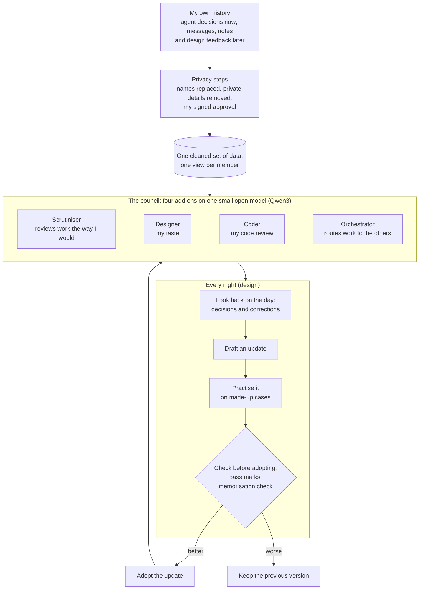

<picture>
  <source media="(max-width: 767px) and (prefers-color-scheme: dark)" srcset="assets/banner-dark-m.svg">
  <source media="(max-width: 767px)" srcset="assets/banner-light-m.svg">
  <source media="(prefers-color-scheme: dark)" srcset="assets/banner-dark.svg">
  
</picture>

**A personalised human you run on your own hardware, built to intercept, audit and filter AI output before it
reaches you: the made-up claims, the hallucinations and the subpar results.**

[](https://github.com/Sohwhat6420/human-llm-council/actions/workflows/test.yml)
[](#what-exists-today)
[](LICENSE)

> [!NOTE]
> **This is a preview.** The pictures show the design, not a working product. What exists today is a benchmark,
> which is a fixed test: 1,887 real questions that AI agents asked me, with the answer I chose each time. It has
> been run against untrained models. No model has been trained on my data yet, and there is nothing to install.
> [What exists today](#what-exists-today) lists every part.

## What it is for

AI agents hand back work that sounds finished. Often it is not. It is the old version, or half done, or built on
a claim the agent made up. You type the correction. The next day you type the same correction again.

The Council is a small model of your own judgement that reads the agents' work before you do. It predicts what
you would say about it. When the work is slop, the Council sends it back to the agent with the feedback you
would otherwise have to repeat. You only see what passes.

It is not a yes/no approver. Accepting or rejecting is the easy part. The hard part is knowing what you would
say, down to "I already said this yesterday".

<picture>
  <source media="(max-width: 767px) and (prefers-color-scheme: dark)" srcset="assets/explainer-dark-m.svg">
  <source media="(max-width: 767px)" srcset="assets/explainer-light-m.svg">
  <source media="(prefers-color-scheme: dark)" srcset="assets/explainer-dark.svg">
  
</picture>

The picture shows a real case. On 11 November 2026 an agent showed me a preview of a README that a newer version
had already replaced. I always reject stale work. A council that knows that would have sent it back before it
reached me.

Each person trains their own council on their own decisions, and can name it after themselves. The one in this
repository is mine, so every count and score here comes from my own decisions.

## How it will work

One small open model does the work of four members. The model is Qwen3, with each of its numbers squeezed into 4
bits so it fits on a laptop. Each member is a small add-on trained for one job (a LoRA adapter), and all four
share the same base model. The members send work back with the feedback I would give. I see what passes, and I
always have the last word.

| Member | Its job | State |
| --- | --- | --- |
| **Scrutiniser** | Reviews work the way I would and flags what I would reject | Being built first |
| **Designer** | My taste in layout and visuals | Planned |
| **Coder** | My code review | Planned |
| **Orchestrator** | Sees all of my data and routes work to the others | Planned |

It runs on your own hardware because of what it has to learn from. To learn how you judge, a model has to train
on your private history: the choices you make, and later your messages and notes. If that needed a data centre,
your history would have to leave home. On an ordinary laptop it does not, and anyone can train their own.

So far, a training test on synthetic (made-up) data fitted a 1.7-billion-parameter Qwen3 into 3.34 GB of
graphics memory on a 6 GB laptop graphics card, the kind in a mid-range gaming laptop. The planned
4-billion-parameter model has not been measured on that laptop yet. The first real training run may rent a
graphics card for about an hour, and only with my approval.

<details>
<summary><b>The full design: data, privacy steps, council and nightly update</b></summary>



Each night the members are meant to look back on the day, draft an update to themselves, practise it on made-up
cases, and keep it only if it scores better on decisions it has not seen. That loop is design only for now. The
data work runs on my laptop. The large cloud models that plan and judge updates see overall scores and made-up
cases, never my raw data. One planned exception: the first real training run may use a rented graphics card for
about an hour, and only if I approve uploading the cleaned training files, with names already replaced.

</details>

## What exists today

Status on 11 November 2026.

| Part | State | Evidence |
| --- | --- | --- |
| The benchmark for the Scrutiniser | **Built and run on my data.** 1,887 questions that Claude Code agents asked me between 2 July and 10 November 2026, each with the one option I chose. 1,510 are for a model to learn from. The newest 375 (3 to 10 November) are the test. The other 2 repeated an earlier question, so they were left out. The test questions were locked before any model saw them. | [`build/council_eval/`](build/council_eval/) |
| Untrained models | **Run** on the 375 test questions, with the options shuffled and the agent's own suggestion hidden. The best one, qwen3:4b with no training on my decisions, picked what I picked about two times in three. Picking at random gets about two in five. | [The benchmark](#the-benchmark-in-plain-words) |
| Privacy steps | **Built and tested** for agent decisions: reading the transcripts in, separating my words from other people's, finding private details, replacing names, removing what must not be kept, my signed approval, and the memorisation check after training. The same steps for messages and notes are **designed, not built**. | [docs/PRIVACY-PIPELINE.md](docs/PRIVACY-PIPELINE.md) |
| Laptop training test | **Run on made-up data only.** A 1.7-billion-parameter Qwen3 was trained on a laptop graphics card (RTX 3060, 6 GB): 27.5 minutes of training, using 3.34 GB of graphics memory at most. A memorisation check planted 5 marker rows in the training data, and the trained model gave away none of them. The same check caught all 5 when a small model was trained to memorise them on purpose, which shows the check works. Method: QLoRA, which trains a small add-on on top of the shrunk model. | [`build/train/`](build/train/) |
| Scrutiniser trained on my real data | **Not started.** It waits for my own approval of the cleaned training files. | |
| Checking how consistent I am | Tool **built**: a local web page that asks me 40 of the test questions again, to measure how often I agree with myself. Not taken yet. | [`build/retest/`](build/retest/) |
| Designer, Coder, Orchestrator | Design only. | |
| Nightly update | Design only. | |
| Answering agents' questions for me | Design only. I will always see the agent's question with the council's answer filled in, and I can change it. It never answers behind my back. | [docs/PRIOR-ART.md](docs/PRIOR-ART.md) |
| Research | Notes on competitors, self-improvement, architecture, data sources, hardware and prior art. They stay private until every citation is checked; an audit found some were wrong. | Private notes |

<details>
<summary><b>What is in this repository</b></summary>

| Path | What it is |
| --- | --- |
| [`build/council_eval/`](build/council_eval/) | The benchmark code, in plain Python with no extra packages. It reads agent decisions from local transcripts, strips private details, splits them by time and locks the test, builds the blind, shuffled questions, runs the simple comparison rules and a local model, scores them against pass marks fixed in advance, and prepares the training files, the review sheet and the signed approval. |
| [`build/train/`](build/train/) | The training script. It refuses to run without a valid approval and throws away any result that gives away a planted marker row. Also the run that proves the memorisation check works, and a row-length check. |
| [`build/tests/`](build/tests/) | 21 pytest tests on made-up transcripts. |
| [`build/retest/`](build/retest/) | The consistency retest: a web page that only this computer can reach, and its scorer, with 14 tests and a smoke test on made-up data. |
| [`docs/BENCHMARK.md`](docs/BENCHMARK.md) | The benchmark in more detail, and the pass mark. |
| [`docs/PRIVACY-PIPELINE.md`](docs/PRIVACY-PIPELINE.md) | The privacy design: hard rules, the steps, consent. |
| [`docs/PRIOR-ART.md`](docs/PRIOR-ART.md) | Prior art and the defensive publication. |
| [`assets/`](assets/), [`tools/banner/`](tools/banner/) | The banner and the explainer (animated SVG; wide and phone versions, light and dark), the 1280 × 640 social preview, and the script that builds them. |

</details>

## The benchmark, in plain words

The first member, the Scrutiniser, starts with something that can be checked. When an AI agent stops and asks me
to choose between options, the model has to predict which one I pick. That is narrower than the goal above, but
the answer is clear: the prediction either matches what I really chose or it does not.

The questions are real. 1,887 times between 2 July and 10 November 2026, a Claude Code agent asked me to pick
one option. (Those sessions ran on Anthropic's cloud models. Everything the council does with the transcripts
afterwards runs on my laptop.) A model learns from the earlier ones and is tested on the newest 375, so it has to
predict choices it has never seen.

The test is blind. Agents often mark one option as "recommended", and I usually take it. The benchmark hides
that mark and shuffles the options, so a model cannot score by spotting the agent's pick.

Nothing is trained yet. The best model so far, qwen3:4b run as it comes on a laptop, picked what I picked about
two times in three. Picking at random gets about two in five. On the decisions where I did not take the agent's
suggestion it did much worse: it got most of those wrong.

Those decisions matter most. A rule that always agrees with the agent looks good on paper, because I agree with
the agent most of the time. But it was wrong every single time I disagreed, which is exactly when a filter
matters. So a trained model has to pass twice: on all the test questions, and on the ones where I went against
the agent. Closing that gap is what training is for.

More detail, and the pass mark, are in [docs/BENCHMARK.md](docs/BENCHMARK.md).

## Run the tests

There is no model to install yet. What you can run is the test suite. It uses made-up transcripts and needs none
of your data. You need Python 3, and Node 18 or later for the retest tool's tests. If your system only has
`python3`, use that in place of `python`.

```bash
git clone https://github.com/Sohwhat6420/human-llm-council && cd human-llm-council/build
```

```bash
python -m pip install pytest && python -m pytest -q tests
```

```console
21 passed
```

```bash
node --test retest/test/retest.test.mjs
```

```console
# tests 14
# pass 14
# fail 0
```

## Security and privacy

- Raw data is processed only on the owner's machine, by models that run there. Cloud models are given the shape
  of the data and made-up examples, never real rows.
- Other people are third parties. Their names are replaced with stable codes (keyed hashes, HMAC) and a role tag
  such as peer or family, so how I talk to someone survives and who they are does not. Rows that mention minors
  are dropped, not edited (a keyword filter today; a check by a local model is designed). A close person's words
  are never used as a training target without their consent.
- Training is checked twice. Before: it will not start without my signed approval, which is tied to the exact
  files I reviewed (by their SHA-256 fingerprints). After: a memorisation check looks in the trained model for
  marker rows planted in the training data, and a control run proves the check can catch a leak.
- Transcripts are treated as untrusted text, because someone could plant instructions in them (prompt injection,
  the first risk on OWASP's top ten for LLM applications). The code reads them as data and never follows or runs
  anything in them. The retest page can only be reached from the same computer.

Not in this repository, by design: any data, transcript, export, training file, review sheet, trained add-on or
model weights; the research notes; and every name other than mine. The code reads its private settings (the name
table, the secret key, extra exclusions) from `build/local/`, which git ignores. The privacy design is in
[docs/PRIVACY-PIPELINE.md](docs/PRIVACY-PIPELINE.md).

## Prior art / defensive publication (11 November 2026)

This builds on earlier work, and says so: agents that simulate individual people (Park et al. 2024), a model that
learns a user's permission decisions (Wu et al. 2025), and patents from Microsoft and Meta on predicting user
responses. A model of one person that answers for them is not new.

To my knowledge, no public benchmark scores a model of a user on the times the user went against the agent. Two
methods are published openly here, dated 11 November 2026, so they stay free for anyone to use: **training and
testing with the agent's recommendation hidden**, and **a check that the model gets right the times I went
against the agent before it is allowed to answer for me**. Full descriptions and citations:
[docs/PRIOR-ART.md](docs/PRIOR-ART.md). There is no patent or patent application on any of it.

## Licence

Apache-2.0. See [LICENSE](LICENSE). By Ethan Soh ([Sohwhat6420](https://github.com/Sohwhat6420)). Questions and
corrections are welcome as [issues](https://github.com/Sohwhat6420/human-llm-council/issues). The type in the
banner and the explainer is Instrument Serif, Hanken Grotesk and JetBrains Mono (SIL OFL 1.1, licences in
[`tools/banner/fonts/`](tools/banner/fonts/)).
