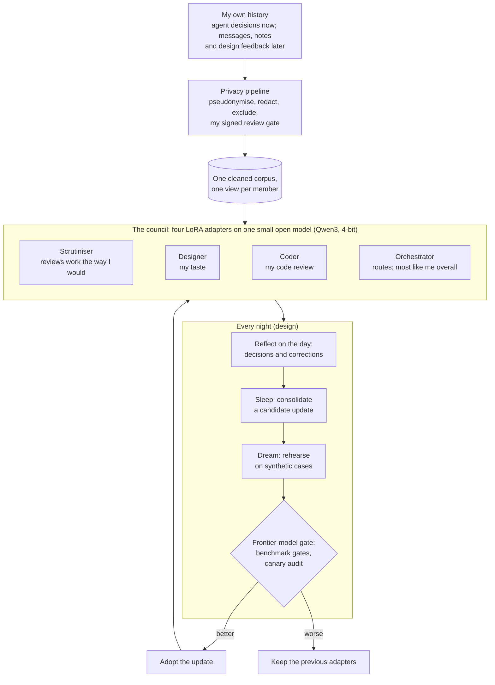

# Ethan Council


[](https://github.com/Sohwhat6420/ethan-council/actions/workflows/test.yml)


**A council of small local models that think the way I do.** Four specialists, a Scrutiniser, a Designer, a
Coder and an Orchestrator, each a LoRA adapter on a small open model, trained on my own decisions. Each night
they are meant to reflect, sleep, dream and update their weights, with frontier models planning and gating
every update so the council cannot make itself worse. It runs on a laptop, so my data stays at home.

**Why it's interesting:** my AI agents ask me hundreds of multiple-choice questions a month, and I take
their recommended option 81.7% of the time. A model of me that scores well on those questions might just be
copying the agent. This project measures the part that matters: it hides the agent's recommendation,
shuffles the options, holds out my newest decisions, and refuses to ship a model unless it also predicts the
cases where I *overrode* the agent. Both methods are published openly in [docs/PRIOR-ART.md](docs/PRIOR-ART.md).

By Ethan Soh ([Sohwhat6420](https://github.com/Sohwhat6420)). **This is a preview:** the first research round is done,
the first benchmark is built and measured, and no model has been trained on my real data yet.

```bash
git clone https://github.com/Sohwhat6420/ethan-council && cd ethan-council/build
python -m pip install pytest && python -m pytest -q tests     # 21 tests, synthetic transcripts only
node --test retest/test/retest.test.mjs                       # 14 tests for the retest tool (Node 18+)
```

## Status (11 November 2026)

Measured or built only. Nothing in this table is a projection.

| Part | State | Evidence |
| --- | --- | --- |
| Research | 14 research lanes returned (competitors, self-improvement, architecture, data sources, hardware, market and others), plus a synthesis, an audit of the load-bearing claims and a patent and prior-art check. 3 lanes not run. Several lanes are not yet audited by a second model, and the audits found wrong citations in some, so the notes stay private until their citations are verified. | Private notes |
| Scrutiniser benchmark | **Built and run on my data.** 1,887 single-choice decisions (2 Jul to 10 Nov 2026) from my Claude Code sessions; 1,510 for training, 375 held out by time (3 to 10 Nov), test ids frozen by SHA-256. | [`build/council_eval/`](build/council_eval/) |
| Baselines | **Run** on the 375 held-out decisions, options shuffled, recommendation hidden. Chance is 39.8%. Best untrained arm: qwen3:4b zero-shot, **65.6%** (95% CI 60.7 to 70.2). | Table below |
| Privacy pipeline | Stages 0 to 5 and 7 **built and tested** for agent decisions. Message and note sources are **designed, not built**. | [docs/PRIVACY-PIPELINE.md](docs/PRIVACY-PIPELINE.md) |
| Laptop training test | **Run on synthetic data only.** Qwen3-1.7B, 4-bit QLoRA on an RTX 3060 Laptop GPU (6 GB): exit 0, 27.5 min of training, peak 3.34 GB VRAM allocated. Canary audit: 0 of 5 leaked; its positive control caught 5 of 5. | [`build/train/`](build/train/) |
| Scrutiniser LoRA on real data | **Not started.** It waits for my own review-gate approval of the cleaned training files. | |
| Self-consistency retest | Tool **built** (a local web page that re-asks 40 held-out questions, to measure how often I agree with myself). Not taken yet. | [`build/retest/`](build/retest/) |
| Designer, Coder, Orchestrator | Design only. | |
| Nightly reflect, sleep, dream, update | Design only. | |
| Auto-answer mode | Design only. It will always show the agent's question with the council's pick preselected; it never answers silently. | [docs/PRIOR-ART.md](docs/PRIOR-ART.md) |

### Held-out results (n = 375, options shuffled, recommendation hidden)

| Arm | Accuracy | When I took the recommendation (n = 239) | When I overrode it (n = 53) |
| --- | --- | --- | --- |
| Random | 36.0% | 38.9% | 30.2% |
| Always the first option | 38.1% | 39.3% | 37.7% |
| Oracle: the agent's own recommendation (reads metadata the models cannot see) | 71.5% | 100% | **0%** |
| qwen3:4b zero-shot, laptop GPU | **65.6%** | 79.9% | 17.0% |
| qwen3:4b + 4 retrieved past decisions | 61.1% | 72.4% | 24.5% |

On unshuffled rows, "always answer option 1" scores 79.2%, which is why that number is never used. The
oracle row is the trap: copying the agent beats every model overall and gets every override wrong.

**The bar a trained Scrutiniser has to clear (fixed before training):** at least 70.6% overall (the best
baseline plus 5 points) with McNemar p < 0.05 against it, **and** at least 24.5% on overrides, no material
drop when I follow the recommendation, at most 1% unparsed replies, and zero canary leaks.

## How it fits together



The data work runs on my laptop. The frontier models that plan and judge updates see aggregate scores and
synthetic cases, never my raw data. The one planned exception: the first real training run may use a rented
GPU for about an hour, and only if I approve uploading the cleaned, pseudonymised training view.

The first demo is the Scrutiniser, because it has a clean target: predict my answer to a question an agent
actually asked me, and score it against what I really chose.

## What is in this repository

| Path | What it is |
| --- | --- |
| [`build/council_eval/`](build/council_eval/) | The benchmark harness, pure Python standard library: ingest of agent decisions from local transcripts, the scrubber, the time split and freeze, blind and shuffled prompts, baselines, a local Ollama predictor, metrics (Wilson intervals, exact McNemar, paired bootstrap, Brier, ECE, follow and override accuracy) and the pre-registered gates, the training view with canaries, the review sheet and the SHA-256-bound approval. |
| [`build/train/`](build/train/) | The LoRA training script (TRL, completion-only loss, QLoRA on small GPUs). It exits without a valid approval and discards an adapter that leaks a canary. Also the canary positive control and a row-length check. |
| [`build/tests/`](build/tests/) | 21 pytest tests on synthetic transcripts. |
| [`build/retest/`](build/retest/) | The self-consistency retest: a loopback-only web page and scorer, with 14 tests and a headless smoke test on synthetic fixtures. |
| [`docs/PRIVACY-PIPELINE.md`](docs/PRIVACY-PIPELINE.md) | The privacy design: hard rules, the stages, consent. |
| [`docs/PRIOR-ART.md`](docs/PRIOR-ART.md) | Prior art and the defensive publication. |

**Not in this repository, by design:** any data, transcript, export, corpus, review sheet, adapter or
weights; the research notes; and every name other than mine. The code reads its private settings (alias
table, HMAC key, extra exclusions) from `build/local/`, which git ignores.

## Prior art / defensive publication (11 November 2026)

This builds on earlier work, and says so: Park et al. 2024 (agents that simulate individuals from
self-reports), Wu et al. 2025 (a model that learns a user's permission decisions), Microsoft's 2018 patent
family on predicting user responses (US 10,878,805 B2, US 11,823,661 B2, US 12,469,485 B2, EP 3 891 596 B1)
and Meta's US 12,513,102 B2. A model of one person that answers for them is not new.

To my knowledge no public benchmark scores a user-proxy on the cases where the user overrode the agent. Two
methods are published openly here, dated 11 November 2026, so they stay free for anyone to use:
**recommendation-blind training and testing** and **the override-accuracy deployment gate**. Full
descriptions and citations: [docs/PRIOR-ART.md](docs/PRIOR-ART.md). Nothing here is patented and no patent
has been applied for.

## Security and privacy

- **Local-first.** Raw data is processed only on the owner's machine by local models. Remote models get
  schemas and synthetic examples, never rows.
- **Other people are third parties.** Names become stable HMAC tokens with role tags; anything involving
  minors is dropped, not redacted; a close person's words are never a training target without their consent.
- **Training is gated twice:** before (a signed approval bound to the files' SHA-256s) and after (a canary
  memorisation audit with a positive control).
- **Transcripts are untrusted text** (OWASP LLM01): the harness parses them as data and never executes or
  follows anything in them. The retest server listens on loopback only.

## Licence

Apache-2.0. See [LICENSE](LICENSE).
