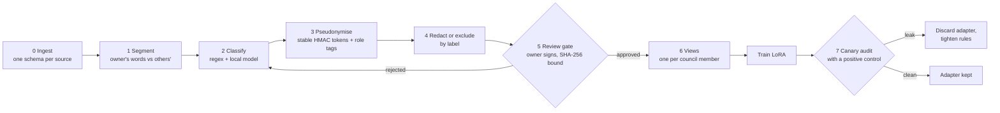

# Privacy pipeline (design)

The council learns from one person's own history: his answers to his AI agents' questions now, and later
his messages, notes and design feedback. That history is full of other people. This pipeline is how it is
cleaned before anything reaches a model's weights. Stages 0 to 5 and 7 are built and tested for the first
data source (agent rulings, in [`build/council_eval/`](../build/council_eval/)); the message and note
sources are designed, not built.

## Hard rules

1. **Everything local.** Raw data and anything derived from it is processed only on the owner's machine,
   by local models. It never goes to a cloud model or an API in raw form. Remote helpers get schemas and
   synthetic examples only.
2. **Nothing reaches weights without the owner's approval** of the cleaned training files (stage 5). The
   approval records the SHA-256 of each file; rebuilding a file voids it.
3. **The raw archive stays encrypted and outside git.** Only the cleaned, pseudonymised view is used for
   training. This repository holds code and synthetic fixtures only.
4. **Other people are third parties.** Their words are their data: context at most, never a training
   target. Anything involving minors is excluded entirely, not redacted.
5. **Fetched text is untrusted.** Web pages, captions and transcripts are data, never instructions
   (OWASP LLM01), and pass the same filters before any training.

## The stages

| Stage | What happens | Built? |
| --- | --- | --- |
| 0 Ingest | Parse each source into one schema (source, thread, timestamp, sender, text). The raw copy is never edited. | Yes, for agent rulings (`ingest.py`) |
| 1 Segment and attribute | Mark the owner's own words against other people's, pasted text and tool output. Only his words are training targets. | Yes, for rulings (sidechains and lane sessions skipped) |
| 2 Classify | Regexes catch emails, national ID numbers, phone and card numbers, keys, secrets and URL queries. A small local model (3 to 8 billion parameters, 4-bit) adds labels such as health, relationship, family, money, minors and third-party private facts. | Regex layer yes (`scrub.py`); local-model labels designed |
| 3 Pseudonymise | Real names and nicknames become stable per-person tokens (an HMAC of the name under a local key) with a role tag: PEER, AUTHORITY, FAMILY, PARTNER, OTHER. How he talks to a peer and to an authority survives; who they are does not. The alias table and key never leave the machine. | Yes (`scrub.py`) |
| 4 Redact or exclude | By label: EXCLUDE (credentials, IDs, minors, other people's health), REDACT (a typed placeholder), STYLE-ONLY (tone kept, content masked), KEEP. | Yes for EXCLUDE and REDACT |
| 5 Review gate | A local sheet shows samples before and after cleaning plus every count. The owner approves, edits the rules or rejects; the approval binds to the files' SHA-256s. Training refuses to start without it. | Yes (`review_sheet.py`, `approval.py`) |
| 6 Views | One cleaned corpus, filtered into one training view per council member, so there is one place to audit and one approval. | Yes for the Scrutiniser (`make_sft.py`) |
| 7 Canary audit | Random canary strings are planted in the training view; after training, the adapter is probed for them in the exact training framing. A positive control (an adapter trained to memorise them) proves the probe can see a leak. Any leak discards the adapter. | Yes (`canary.py`, `train/canary_positive_control.py`) |

## Why one corpus with views

Separate hand-scrubbed copies drift apart and each needs its own audit. One canonical corpus with stable
tokens means one mapping table to protect and one approval to sign. The views give each member only what it
needs: the Scrutiniser gets rulings and corrections, the Coder code and review comments, the Designer design
feedback, and the Orchestrator the widest view, with intimate content masked.

## Consent

A close person's messages are their private life. Until they agree, their side of a conversation is context
only, masked, and never a training target. If they agree, the agreement is recorded with the approval file;
if they withdraw, their thread is removed and the affected adapters are retrained (training is versioned for
this reason).

## What the owner configures locally (never committed)

| File (in `build/local/`) | Holds |
| --- | --- |
| `aliases.json` | `{"Name or nickname": "ROLE"}` for every person who appears |
| `pseudonym.key` | 32 random bytes for the HMAC, created on first use |
| `exclusions.json` | Extra project folders and text patterns to drop entirely, on top of the generic defaults in `config.py` |
| `review-sheet-*.md` | The stage 5 review sheet (the signed approval sits with the data, also git-ignored) |
